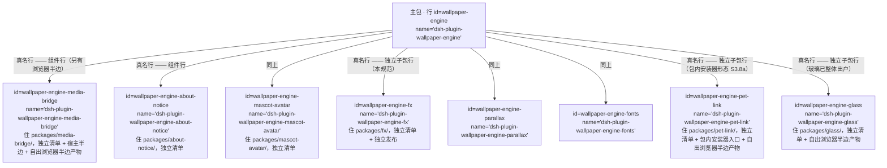
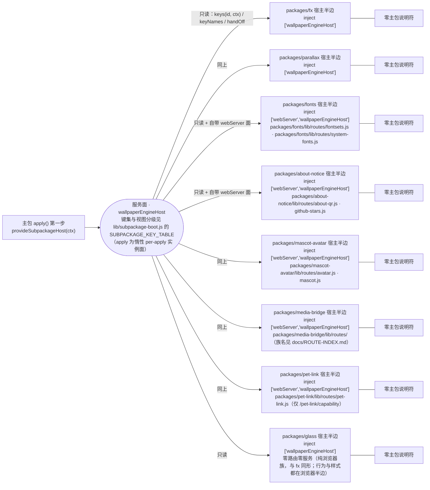
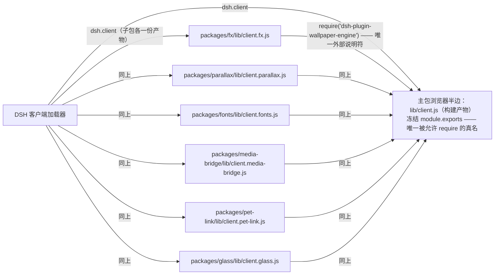

# 子包依赖图（人工维护速查，可能滞后；以代码与守卫为准）

> **规范在 [ADR-0014](./adr/0014-subpackage-contract.md)**（条款号 `S*`）—— 本文只画"长什么样、谁连谁"，
> 不复述条款，也不定义契约。
> **本文没有机器判据**（ADR-0014 的 D3/D4）；按 ADR-0017 D5，它只保留"长什么样、谁连谁"的索引，
> **不抄条数 / 键表 / 日期**，包一改请以守卫输出与生成物为准。语言：维护者向，只出中文。

## 改本文之前 / 读本文之后：复算命令

下面几条都是**只读扫描**（最后两条会重算生成物）。它们是本文的"防腐化手段" ——
仓库**不**拿它们判本文对错（用户口径：针对 markdown 的机械判据一律不设）。

```bash
ls packages/*/package.json                                # 在册独立子包
git grep -n "id: wallpaper-engine" -- cordis.patch.yml    # 主包 patch 里的行（两种行都在这里）
git grep -n "file:packages/" -- package.json              # 开发期依赖形态（S8.1）
git grep -n "from '" -- packages                          # 宿主半边的 import 面（S5.1 / S5.3）
git grep -n 'require("dsh-plugin-wallpaper-engine")' -- packages   # 浏览器平面唯一说明符（S5.2）
node test/tools/host-route-index.mjs --write              # 重算 docs/ROUTE-INDEX.md
node test/tools/guard-targets.mjs --write                 # 重算 docs/GUARD-MAP.md
```

## 一、行树：主包挂的两种行

`cordis.patch.yml` 里两种行**名字形态不同、寿命不同**（术语见 S1.1），混读是这张图最常被误读的地方。



- **组件行**：代码在主包 `files` 里、随主包发布，清单就是主包清单；本仓现存的三格
  （`about-notice` / `mascot-avatar` / `media-bridge`）都已出户到 `packages/<pkg>/` ⇒ 它们**同时**是
  组件行（由 `COMPONENT_VIEW_KEYS` 声明面回答"是不是组件"）与独立子包行（S3–S10）。
- **独立子包行**：真名行，代码在自己目录、有独立清单 / 独立发布 / 独立开关（S3–S10 管的是它）。
- **host-only 形态仍然合法**：宿主侧功能为主的子包可以只有宿主半边；不要为了"看起来统一"补空 `./client`（S3.4）。

## 二、宿主平面（进程内、cordis 行）

主包在 `apply()` 的**第一步**把跨包通道 `provide` 成一个服务；子包 `inject` 之后**只读**取用，
宿主半边里**零主包说明符**。



- 每个子包能拿到**哪些键**由主包 `lib/subpackage-boot.js` 的 `SUBPACKAGE_KEY_TABLE` 按 **id**（= 行 id 去掉
  `wallpaper-engine-` 前缀）供给，**双向对账**：表里多一项、少一项都红（S10.1）。
- 行的**位置与顺序**是主包 `cordis.patch.yml` 的事；子包自己那份 `cordis.patch.yml` 只在"把它当独立 bundle"
  时生效，两处的 `(id, name)` 必须逐字相等（S4.2）。
- 主包行被关掉 ⇒ 服务面消失 ⇒ 子包 fiber **级联 park**（不是"半挂"，S7.2）。
- **`apply` 键是惰性 per-apply 实例视图**（S5.4）：`provide` 排在 `apply()` 第一步（早于会话构造），
  读取发生在子包 apply / 组件行装载时；**实例必须同源** —— `mediaMap` / `tokenFor` / `serveFile` / `serveLayout` /
  `handleSceneFiles` 取主包本会话那份，不得用组件会话自建的第二张 `mediaMap`（否则 token 全 404，
  判据 `test/verify-token-domain.mjs`）。纯符号走 `schema` / `http` 视图，不混进实例面。

## 三、浏览器平面（构建产物、客户端加载器）

浏览器半边**不能**在运行时互相 import：子包产物**唯一**允许的外部说明符是主包真名，
由构建期发出（S5.2）；主 bundle 的 `module.exports` 就是那条冻结面。



- 子包产物由**包内配方** `packages/<pkg>/client.build.json`（`artifact` / `entry` / `inline[]`）驱动
  `scripts/build-client.mjs` 逐项构建（产物被 `.gitignore` 排除、**不进 git**）；声明面
  （`exports['./client']` + `dsh.client`）与配方、盘上产物三方对账（S3.4 / S10.2）。
- 本仓今天**两种形态并存**：带浏览器半边的子包（`fx` / `parallax` / `fonts` / `media-bridge` / `pet-link` / `glass`）
  与 host-only 的子包（`about-notice` / `mascot-avatar`，浏览器半边仍内联主包 `src/**`）。
  **不要**为了"看起来统一"给 host-only 包补一个空的 `./client`（S3.4）。

## 四、边表（允许 / 禁止）

| # | 从 → 到 | 允许？ | 依据 |
|---|---|---|---|
| 1 | 主包 `apply()` → 服务面（`provide`） | ✅ | S5.4 |
| 2 | 子包宿主半边 → 服务面（只读 `keys` / `keyNames` / `handOff` / `schema` / `http` / `apply`） | ✅ 只读取用（`apply` = 惰性 per-apply 实例面，必须与主包会话**同实例**） | S5.4 |
| 3 | 子包宿主半边 → 主包（任何 value import，含旧叶子写法） | ❌ | S5.1 / S5.3 |
| 4 | 子包宿主半边 → 另一个子包 | ❌ | S5.3 |
| 5 | 主包实现 → 子包实现文件（绕过行名直接 import） | ❌（主包只按**行名**挂载） | S5.3 / S4.4（例外见 S5.3） |
| 6 | 子包产物 → 主包真名 `require` | ✅ **唯一** | S5.2 |
| 7 | 子包源码（`src/**`）→ `require` / `import` | ❌（说明符只许构建期发出） | S5.2 |
| 8 | 子包 ⇄ 主包 / 子包 ⇄ 子包的 **npm 依赖**（任一侧把对方名写进 `dependencies` / `peerDependencies`） | ❌ | S3.5 |
| 9 | 子包 `peerDependencies` → 主包 `peerDependencies` | ✅ 且 `@deepseek-ai/*` 范围**逐字**取根 | S3.5 |
| 10 | 行 ⇄ 清单（主包 patch 行 ↔ `packages/*/package.json` 的 `name`） | ✅ **双向**（无死行、无未登记的包） | S4.1 |

判据名（谁钉住这些边）：`verify-subpackage-boot`（1/2 的服务面键表与 `apply` 惰性）、`verify-subpackage-purity`（3/4/5）、
`verify-subpackage-client-half`（6/7）、`verify-subpackage-manifests`（8/9 与清单面）、
`verify-bundle-rows` + `test/tools/host-route-index.mjs`（10）、`verify-token-domain`（2 的"同实例"）、
`verify-occlusion-hub`（壁纸包宿主半边的 hub 构造唯一性）。

## 五、新增子包的登记点

登记点由守卫自动发现：`verify-subpackage-manifests` / `verify-subpackage-boot` / `verify-package-files`，
生成物用 `node test/tools/host-route-index.mjs --write` 与 `node test/tools/guard-targets.mjs --write` 重算。
需要人做的只有 `(id, name)` / `icon.png` / `locale` / `client.build.json` —— 契约见
[`adr/0014`](./adr/0014-subpackage-contract.md) S3–S10。

`glass` 是最近的完整样例：宿主半边是零路由空壳，浏览器半边由 `client.build.json` 自出
`lib/client.glass.js`（`exports['./client']` + `dsh.client` 三方对账），运行时与 CSS 都在该包内；
行 / 键表项 / 根清单 `file:` 依赖 / 同批重算的 `package-lock` 齐全即入册。

## 六、这张图会怎么漂

1. **新增 / 删除一个独立子包**：三张图与边表要一起改；清单面 / 登记点由守卫兜住。
2. **行的 id / name 改名**：图里的标签失真；`id` 是用户覆盖面锚点（S4.3），改名代价很大。
3. **半边搬迁**（host-only ↔ 自出产物）：§三 的两类要一起改，并同步 S3.4 的说明。
4. **真发布**（S8.2 从开发期切到发布期）：§四 边表之外没有要改的格 —— 发布面由
   `verify-package-publish.mjs` 钉"全有或全无"。

改本文时**不必**改 ADR-0014（那是决策记录）；除非触发 ADR-0014 §复核触发线四条之一。
